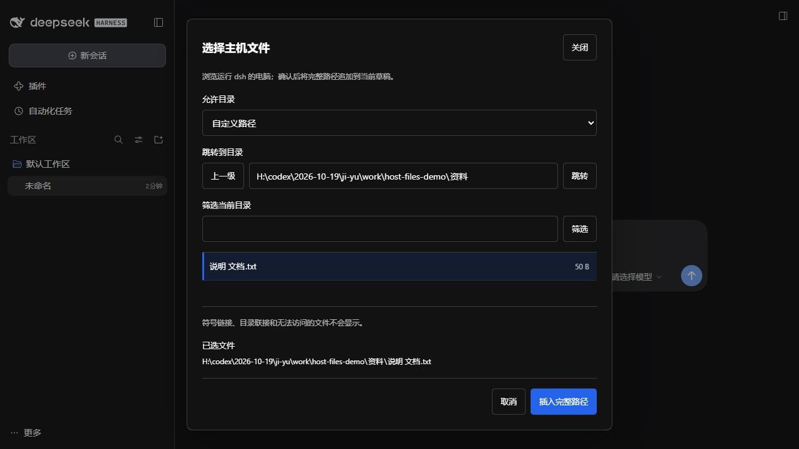
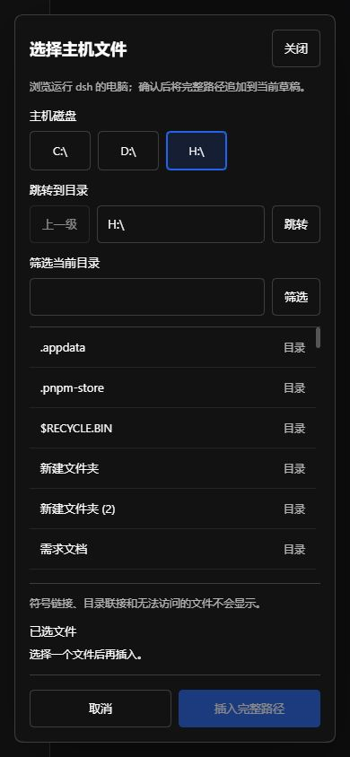

# dsh-frpc-remote

为 **DeepSeek Harness 0.2.1-rc.2** 增加「设置 → 远程访问」页面，配置并托管 frpc，让浏览器从远程入口操作本机 dsh。插件使用当前 dsh Host，桌面端自动分配的监听端口也会自动读取。


## 安装

程序路径默认为 `auto`。插件先检测系统 PATH 和已有安装；缺失时可点击「自动安装」，或在启用连接时自动下载官方 **frp 0.71.1**。下载包经过固定 SHA-256 校验，再验证程序版本；插件包本身不携带 frpc。

从 GitHub 安装固定版本到现有桌面 profile：

```powershell
dsh plugin --profile desktop add github:LItterBoy-GB/dsh-frpc-remote#v0.3.2
```

源码直接运行，不需要安装脚本或构建。也可以在源码目录运行 `npm pack --ignore-scripts`，再安装生成的本地包：

```powershell
dsh plugin --profile desktop add .\dsh-frpc-remote-0.3.2.tgz
```

如果 `dsh` 没有加入 PATH，使用桌面端自带的命令：

```powershell
& "$env:LOCALAPPDATA\Programs\DeepSeek Harness\resources\runtime\cli\bin\dsh.cmd" plugin --profile desktop add .\dsh-frpc-remote-0.3.2.tgz
```

重新打开 dsh 后进入 **设置 → 远程访问**。默认关闭，没有服务器配置也能打开设置页。也可以将包安装到使用 `dsh-base`、`dsh-web-app` 的其他 Web profile；不要安装到 headless/SDK profile。

## 配置与使用

1. 保留程序路径 `auto`，点击「检测路径」或「自动安装」；也可填写自备 frpc 的完整路径（支持含空格和中文的路径）。填写 frps 地址、连接端口及 Token。
2. 选择代理类型：
   - **TCP**：填写 frps 对外映射端口。HTTPS 入口反向代理到这个 TCP 端口。
   - **HTTP**：按远程访问地址的域名创建 frp 虚拟主机代理，需要 frps 配置 `vhostHTTPPort`，入口反向代理再提供 HTTPS。
3. 填写浏览器真正访问的根地址，例如 `https://dsh.example.com/`。本版本使用独立域名或端口，不支持路径前缀。
4. 勾选启用并点击「保存并应用」。配置落在 dsh 原生 profile 中，无需手工维护 frpc.toml。
5. 状态显示「代理已连接」后，点击「打开远程入口」或「复制访问链接」。链接使用 dsh 自带的当前进程访问令牌；第一次打开后，由 dsh 换成浏览器认证 cookie。

修改网络配置时 Connection 会短暂重连，插件先返回保存结果再应用隧道重连。仅修改主机文件浏览范围直接热更新，不重启隧道；原样重复保存不重复写入。关闭开关会结束本插件持有的 frpc 子进程；卸载、退出和网络配置更新也会清理子进程及临时文件。不会结束其他已有 frpc 进程。

Token 输入框不回显原值，空白保存保留原 Token，勾选「清除已保存的 Token」才清除。密钥以 dsh 原生 secret 配置字段保存到本机 profile，不使用系统密钥库；生成的临时 TOML 只包含环境变量模板，Token 通过子进程环境传入。不要分享包含凭据的 profile 文件。

保存遇到连接中断时，页面会核对恢复后的宿主配置，不会直接把断线当成修订冲突或自动重复写入。无法确认时保留草稿并提示核对；密钥不会回显，所以密钥写入只有成功回包才能确认。真正冲突时可点击「载入最新配置」，确认放弃草稿后重新编辑。

### 程序检测与自动下载

- `auto`、空白以及旧配置 `frpc` / `frpc.exe` 均自动检测：系统 PATH → 已校验的插件缓存 → 旧版 DSH tools 安装目录。
- 手动指定的路径会检查文件和版本。路径错误时显示原因，不会静默切换到其他程序；手动安装要求 frpc 0.52.0 或更新版本。
- 远程访问关闭时只检测，不会自动下载或连接服务器；仍可主动点击「自动安装」。取消「缺失时自动下载 frpc」后，启用连接也不会触发下载。
- 支持 Windows、Linux、macOS 的 x64 / ARM64 官方包。缓存位置为 `<DSH_HOME>/tools/frp-0.71.1/<系统>-<架构>/`，默认 DSH_HOME 为用户目录下的 `.dsh`。
- 页面显示下载进度、检测结果、实际路径和版本。网络失败或校验失败可重试；也可手动下载官方客户端并填写完整路径。已有程序不会被自动覆盖。
- 自动安装固定使用 [frp v0.71.1 官方 Release](https://github.com/fatedier/frp/releases/tag/v0.71.1)，不获取可变的 latest。仅 Windows x64 完成真实下载与执行验证；其他平台已验证包选择和解压逻辑，尚未做对应系统的运行验证。

## 选择主机文件

对话输入框旁的「选择主机文件」可以浏览**运行 dsh 的电脑**，选择工作区以外的文件，并将完整路径追加到当前草稿。它不切换工作区，不自动发送消息，也不上传或读取所选文件的内容；随后智能体能否读取或修改该文件，仍取决于会话权限与系统权限。

在 **设置 → 远程访问 → 主机文件 → 浏览范围** 中选择：

- **指定多个目录**：每行填写一个完整目录，最多 20 项；文件面板可切换这些目录。默认列表为空，不能浏览任何目录。
- **所有目录**：浏览当前 dsh 系统账号有权限访问的目录。Windows 使用独立磁盘按钮直接切换，适配手机触摸操作，避免依赖内置浏览器的原生下拉菜单；输入 `H:` 也会自动补全为磁盘根目录；也可输入完整目录路径跳转，包括可访问的 UNC 共享。POSIX 从 `/` 开始。

点击「保存并应用」后，在当前会话打开文件面板。点击目录进入，使用「上一级」返回或输入完整目录跳转；筛选只针对当前目录。点击文件，再点击「插入完整路径」。路径以代码文本追加，保留原草稿、附件和引用芯片。关闭面板或切换会话不会把选择插入另一个会话。





此功能沿用 dsh 登录认证，不提供匿名浏览接口。指定目录模式会检查真实路径，拒绝 `..` 越界、前缀相似目录及指向目录外的链接；列表不显示符号链接、Windows 目录联接和无法读取元数据的子项。不会增加系统账号本身没有的权限。一次最多显示 500 项、扫描 5000 项，列表截断时会提示进一步筛选；不是整盘递归搜索。

配置字段示例（路径仅作示例）：

```yaml
allowAllDirectories: false
allowedDirectories:
  - 'H:\项目'
  - 'H:\资料'
```

文件选择与 frpc 开关独立：在本机 dsh 中也可使用；远程访问关闭时，文件面板不会主动建立远程连接。

## HTTPS 入口示例

插件负责本机 frpc，**不会安装或修改 frps、DNS、证书、反向代理或防火墙**。

常见 TCP 链路：

```text
远程浏览器 HTTPS
  → 已有 TLS 反向代理
  → frps TCP 映射端口
  → frpc 加密连接
  → 本机 127.0.0.1:<dsh 实际端口>
```

例如，已有 frps 在 7000 接受客户端、在同机 18080 映射 dsh 时，入口 Nginx 的 location 可配置为：

```nginx
# server 的证书与 443 listener 由现有 HTTPS 入口配置持有。
location / {
    proxy_pass http://127.0.0.1:18080;
    proxy_http_version 1.1;
    proxy_set_header Host $http_host;
    proxy_set_header Origin $http_origin;
    proxy_set_header Upgrade $http_upgrade;
    proxy_set_header Connection $connection_upgrade;
    proxy_buffering off;
    proxy_read_timeout 3600s;
}
```

上面的 `$connection_upgrade` 需要在 Nginx `http` 块已有以下映射：

```nginx
map $http_upgrade $connection_upgrade {
    default upgrade;
    '' close;
}
```

保持 Host、Origin、Cookie、查询参数和 WebSocket upgrade；SSE 不应被缓冲。HTTPS 在入口终止、本机 dsh 继续监听 HTTP 的场景已验证。公网入口 TLS 与 frpc → frps 的 TLS 是两段不同的连接；插件不会仅凭填写 HTTPS URL 就自动生成证书。frps CA 和证书名称可在高级设置中配置。

仅在可信网络测试明文入口时，明确勾选「允许明文 HTTP」。本机 dsh 若已经使用 HTTPS，请选择 TCP 转发，并由部署保持端到端协议一致；HTTP 虚拟主机模式只对接本机 HTTP。

## 状态及故障

- **正在准备**：生成临时配置并执行 `frpc verify`。
- **正在连接**：frpc 已启动，但代理尚未就绪或正在重连。
- **代理已连接**：收到 frpc 的代理成功启动信息；它代表隧道就绪，仍需由实际入口验证 DNS、TLS 和代理配置。
- **等待重启 / 连接失败**：frpc 异常退出、路径错误或校验失败，页面显示经过脱敏的诊断。达到最大异常重启次数后，修正配置并保存可再次启动。

frpc 的网络重连由同一个 frpc 进程负责；插件只在进程退出时执行有上限的重启。关闭、更新及卸载不会触发重启。

## 开发与验证

```powershell
npm ci --ignore-scripts
npm run check
npm pack
```

源码不需要构建；`client.js` 使用 DSH 发布的 lazy-factory 模块协议，复用宿主 React、locale、settings slot 和 ConfigForms。保存走原生 revision 保护；Config 的 `secret` 字段经宿主脱敏；状态、检测和安装接口沿用 `Connection.requestRejection()`，不会提供匿名访问通道。安装与检测请求仅接受 POST，JSON 请求体上限为 8 KiB。

包文件包含运行源码，源码 ZIP 另含测试与锁文件。`test/fixture-frpc.js` 是测试用 Node 子进程，不是 frpc 实现。

本次验证：40 项单元/子进程测试；已安装 0.2.1-rc.2 的独立 profile 中打开设置、检测与自动安装、配置多个目录、选择主机文件及追加草稿；该版本原生 WebServer/Connection 的认证、文件目录边界、请求边界和密钥脱敏；官方 frpc/frps 0.71.1 在 **127.0.0.1** 的真实转发、SSE、WebSocket、热关闭和端口释放。隧道回归使用本机隔离服务。

## 卸载

```powershell
dsh plugin --profile desktop remove dsh-frpc-remote
```

当前 profile 若设置了 live patch reload 会自动刷新；否则重启 dsh。移除 bundle 层后恢复 dsh 原有 Connection 配置。

## 参考

- [DSH 0.2.1-rc.2 Web bundle](https://github.com/deepseek-ai/deepseek-harness/blob/dsh-v0.2.1-rc.2/packages/bundle/web-app/cordis.patch.yml)
- [frp 客户端配置](https://gofrp.org/en/docs/reference/client-configures/)
- [frp 代理配置](https://gofrp.org/en/docs/reference/proxy/)
- [frp TLS](https://gofrp.org/en/docs/features/common/network/network-tls/)
