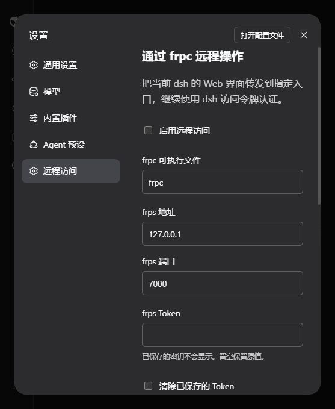

# dsh-frpc-remote

为 **DeepSeek Harness 0.2.1-rc.2** 增加「设置 → 远程访问」页面，配置并托管 frpc，让浏览器从远程入口操作本机 dsh。插件使用当前 dsh Host，桌面端自动分配的监听端口也会自动读取。



## 安装

先准备支持 TOML 和 `verify` 子命令的 frpc；本次验证使用官方 **frp 0.71.1**。插件不附带、也不自动下载或安装 frpc。

从 GitHub 安装固定版本到现有桌面 profile：

```powershell
dsh plugin --profile desktop add github:LItterBoy-GB/dsh-frpc-remote#v0.1.0
```

源码直接运行，不需要安装脚本或构建。也可以在源码目录运行 `npm pack --ignore-scripts`，再安装生成的本地包：

```powershell
dsh plugin --profile desktop add .\dsh-frpc-remote-0.1.0.tgz
```

如果 `dsh` 没有加入 PATH，使用桌面端自带的命令：

```powershell
& "$env:LOCALAPPDATA\Programs\DeepSeek Harness\resources\runtime\cli\bin\dsh.cmd" plugin --profile desktop add .\dsh-frpc-remote-0.1.0.tgz
```

重新打开 dsh 后进入 **设置 → 远程访问**。默认关闭，没有服务器配置也能打开设置页。也可以将包安装到使用 `dsh-base`、`dsh-web-app` 的其他 Web profile；不要安装到 headless/SDK profile。

## 配置与使用

1. 填写 frpc 可执行文件的完整路径、frps 地址、连接端口及 Token。
2. 选择代理类型：
   - **TCP**：填写 frps 对外映射端口。HTTPS 入口反向代理到这个 TCP 端口。
   - **HTTP**：按远程访问地址的域名创建 frp 虚拟主机代理，需要 frps 配置 `vhostHTTPPort`，入口反向代理再提供 HTTPS。
3. 填写浏览器真正访问的根地址，例如 `https://dsh.example.com/`。本版本使用独立域名或端口，不支持路径前缀。
4. 勾选启用并点击「保存并应用」。配置落在 dsh 原生 profile 中，无需手工维护 frpc.toml。
5. 状态显示「代理已连接」后，点击「打开远程入口」或「复制访问链接」。链接使用 dsh 自带的当前进程访问令牌；第一次打开后，由 dsh 换成浏览器认证 cookie。

修改配置时 Connection 会短暂重连。关闭开关会结束本插件持有的 frpc 子进程；卸载、退出和配置更新也会清理子进程及临时文件。不会结束其他已有 frpc 进程。

Token 输入框不回显原值，空白保存保留原 Token，勾选「清除已保存的 Token」才清除。密钥以 dsh 原生 secret 配置字段保存到本机 profile，不使用系统密钥库；生成的临时 TOML 只包含环境变量模板，Token 通过子进程环境传入。不要分享包含凭据的 profile 文件。

## HTTPS 入口示例

插件负责本机 frpc，**不会安装或修改 frps、DNS、证书、反向代理或防火墙**。

常见 TCP 链路：

```text
远程浏览器 HTTPS
  → 已有 TLS 反向代理
  → frps TCP 映射端口
  → frpc 加密连接
  → 本机 127.0.0.1:<dsh 实际端口>
```

例如，已有 frps 在 7000 接受客户端、在同机 18080 映射 dsh 时，入口 Nginx 的 location 可配置为：

```nginx
# server 的证书与 443 listener 由现有 HTTPS 入口配置持有。
location / {
    proxy_pass http://127.0.0.1:18080;
    proxy_http_version 1.1;
    proxy_set_header Host $http_host;
    proxy_set_header Origin $http_origin;
    proxy_set_header Upgrade $http_upgrade;
    proxy_set_header Connection $connection_upgrade;
    proxy_buffering off;
    proxy_read_timeout 3600s;
}
```

上面的 `$connection_upgrade` 需要在 Nginx `http` 块已有以下映射：

```nginx
map $http_upgrade $connection_upgrade {
    default upgrade;
    '' close;
}
```

保持 Host、Origin、Cookie、查询参数和 WebSocket upgrade；SSE 不应被缓冲。HTTPS 在入口终止、本机 dsh 继续监听 HTTP 的场景已验证。公网入口 TLS 与 frpc → frps 的 TLS 是两段不同的连接；插件不会仅凭填写 HTTPS URL 就自动生成证书。frps CA 和证书名称可在高级设置中配置。

仅在可信网络测试明文入口时，明确勾选「允许明文 HTTP」。本机 dsh 若已经使用 HTTPS，请选择 TCP 转发，并由部署保持端到端协议一致；HTTP 虚拟主机模式只对接本机 HTTP。

## 状态及故障

- **正在准备**：生成临时配置并执行 `frpc verify`。
- **正在连接**：frpc 已启动，但代理尚未就绪或正在重连。
- **代理已连接**：收到 frpc 的代理成功启动信息；它代表隧道就绪，仍需由实际入口验证 DNS、TLS 和代理配置。
- **等待重启 / 连接失败**：frpc 异常退出、路径错误或校验失败，页面显示经过脱敏的诊断。达到最大异常重启次数后，修正配置并保存可再次启动。

frpc 的网络重连由同一个 frpc 进程负责；插件只在进程退出时执行有上限的重启。关闭、更新及卸载不会触发重启。

## 开发与验证

```powershell
npm ci --ignore-scripts
npm run check
npm pack
```

源码不需要构建；`client.js` 使用 DSH 发布的 lazy-factory 模块协议，复用宿主 React、locale、settings slot 和 ConfigForms。保存走原生 revision 保护；Config 的 `secret` 字段经宿主脱敏；状态接口沿用 `Connection.requestRejection()`，不会提供匿名访问通道。

包文件包含运行源码，源码 ZIP 另含测试与锁文件。`test/fixture-frpc.js` 是测试用 Node 子进程，不是 frpc 实现。

本次验证：10 项单元/子进程测试；已安装 0.2.1-rc.2 的独立 profile 中打开设置并保存；该版本原生 WebServer/Connection 的认证和密钥脱敏；官方 frpc/frps 0.71.1 在 **127.0.0.1** 的真实转发、SSE、WebSocket、热关闭和端口释放。未连接任何正式服务器，也未配置真实公网入口。

## 卸载

```powershell
dsh plugin --profile desktop remove dsh-frpc-remote
```

当前 profile 若设置了 live patch reload 会自动刷新；否则重启 dsh。移除 bundle 层后恢复 dsh 原有 Connection 配置。

## 参考

- [DSH 0.2.1-rc.2 Web bundle](https://github.com/deepseek-ai/deepseek-harness/blob/dsh-v0.2.1-rc.2/packages/bundle/web-app/cordis.patch.yml)
- [frp 客户端配置](https://gofrp.org/en/docs/reference/client-configures/)
- [frp 代理配置](https://gofrp.org/en/docs/reference/proxy/)
- [frp TLS](https://gofrp.org/en/docs/features/common/network/network-tls/)
